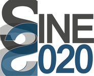

*****
About
*****

MCPL was developed and is maintained by the following persons with
contributions in the indicated areas:

- Thomas Kittelmann (`ESS <https://europeanspallationsource.se/>`__): Main
  developer (all areas)
- Esben Klinkby (`DTU <http://www.dtu.dk/>`__): MCNP hooks
- Erik Bergb\ |auml|\ ck Knudsen (`DTU <http://www.dtu.dk/>`__): McStas & McXtrace hooks
- Peter Willendrup (`DTU <http://www.dtu.dk/>`__): McStas & McXtrace hooks
- Douglas Di Julio (`ESS <https://europeanspallationsource.se/>`__): PHITS
  hooks

A substantial effort went into developing MCPL. If you use it for your work, we
would appreciate it if you would use the following reference in your work:

T. Kittelmann, et al., Monte Carlo Particle Lists: MCPL, *Computer Physics
Communications*, Volume 218, September 2017, Pages 17-42, ISSN 0010-4655,
https://doi.org/10.1016/j.cpc.2017.04.012 :openaccess:`open access`

MCPL is made available under the highly liberal open source Apache 2.0 license
(see :doc:`license`).

.. _about-acknowledgements:

Acknowledgements
----------------

This work was supported in part by the European Union's Horizon 2020 research
and innovation programme under grant agreement No 676548 (the BrightnESS
project) and under grant agreement No 654000 (the SINE2020 project).

Additionally, thanks to the following persons for providing useful feedback and
ideas:

- Kalliopi Kanaki (`ESS <https://europeanspallationsource.se/>`__)
- Xiao Xiao Cai (`ESS <https://europeanspallationsource.se/>`__ &
  `DTU <http://www.dtu.dk/>`__)

.. container:: mcpllogos

   |BrightnESS| |SINE2020| |ESS| |DTU|

