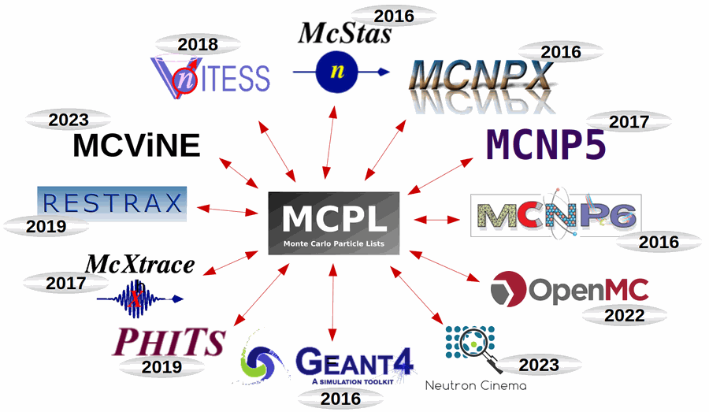

##################################
MCPL - Monte Carlo Particle Lists
##################################

   Applications with MCPL support

Welcome to the home of MCPL, a binary file format for usage in physics
simulations. MCPL files, with extensions ``.mcpl`` and ``.mcpl.gz``, contain
lists of particle state information, and allow for easy storage and
interchange of particles between various Monte Carlo simulation
applications. The MCPL software provides APIs for C, C++ and Python, and
command-line tools for inspecting and modifying files, along with converters
and plugins for several popular simulation packages.

.. note::

   This is the new Sphinx-based MCPL website, which is still in
   development. The current MCPL website is at https://mctools.github.io/mcpl/.

You can browse this documentation in order with the **"Next"** button (or
with the left and right arrow keys), or use the menu or the search box to
navigate to the relevant parts.

.. include:: cite.rst

.. container:: mcplnews

   .. rst-class:: mcplnews-title

   Latest news

   .. include:: ../build/autogen/news_latest.rst

   More in the :doc:`news archive <news>`.

.. _index-a-quick-look-at-a-file:

A quick look at a file
======================

The particles in a file can be summarised with ``pymcpltool --stats``, here
for the example file of the MCPL distribution:

.. figure:: ../build/autogen/stats_overview.png
   :alt: Overview of the particles in an MCPL file

.. toctree::
   :hidden:
   :maxdepth: 2
   :caption: General

   get
   news

.. toctree::
   :hidden:
   :maxdepth: 2
   :caption: Documentation

   file_contents
   usage
   hooks

.. toctree::
   :hidden:
   :maxdepth: 2
   :caption: Reference

   format
   cmdline
   c_api
   python_api
   cpp_api

.. toctree::
   :hidden:
   :caption: About

   about
   contact
   license

.. sidebar-links::
   :github:
   :pypi: mcpl

   Conda <https://anaconda.org/conda-forge/mcpl>
   Issue tracker <https://github.com/mctools/mcpl/issues>
   Discussions <https://github.com/mctools/mcpl/discussions>
   Current website <https://mctools.github.io/mcpl/>
