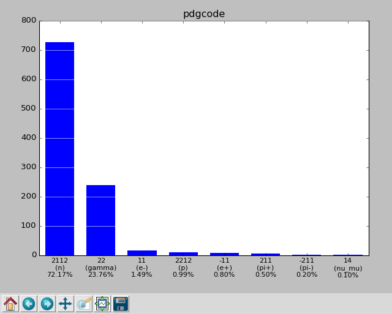
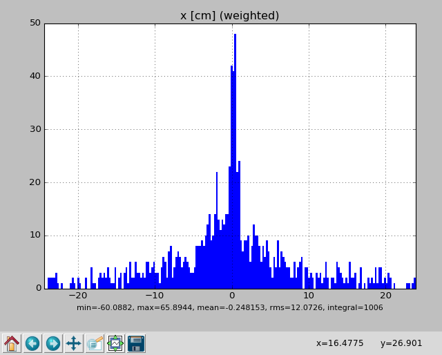
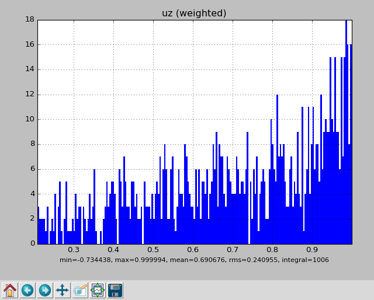

********************************
Using MCPL from the command line
********************************

The MCPL distribution includes a handy command-line tool, ``mcpltool``, which
can be used to either inspect MCPL files, or to carry out a limited number of
operations on them. Since release 1.2, it also includes a second tool,
``pymcpltool``, which provides additional inspection features in the form of
plots and statistics display.

This page includes a few examples of how the command-line tools can be used,
but users are referred to `the MCPL paper (section
2.3) <https://mctools.github.io/mcpl/mcpl.pdf#nameddest=subsection.2.3>`__ for
more information.

.. _usage_cmdline-examples:

Examples
--------

A few examples of how to use the command-line tools are provided here. Note
that a small sample MCPL file is available at
`examples/example.mcpl <https://github.com/mctools/mcpl/raw/HEAD/examples/example.mcpl>`__,
in case new users would like something to try the ``mcpltool`` on.

.. _usage_cmdline-inspect-file-contents:

Inspect file contents
~~~~~~~~~~~~~~~~~~~~~

Simply invoking ``mcpltool`` or ``pymcpltool`` on a file with no additional
arguments, results in a summary of the header information being printed, in
addition to the particle state information of the first ten particles in the
file:

.. code:: shell

   $ mcpltool example.mcpl

::

   Opened MCPL file example.mcpl:

     Basic info
       Format             : MCPL-3
       No. of particles   : 1006
       Header storage     : 140 bytes
       Data storage       : 36216 bytes

     Custom meta data
       Source             : "G4MCPLWriter [G4MCPLWriter]"
       Number of comments : 1
             -> comment 0 : "Transmission spectrum from 10GeV proton beam on 20cm lead"
       Number of blobs    : 0

     Particle data format
       User flags         : no
       Polarisation info  : no
       Fixed part. type   : no
       Fixed part. weight : no
       FP precision       : single
       Endianness         : little
       Storage            : 36 bytes/particle

   index     pdgcode   ekin[MeV]       x[cm]       y[cm]       z[cm]          ux          uy          uz    time[ms]      weight
       0          22      1.2635     -3.5852    -0.81223          20    -0.41453   -0.022799     0.90975  7.3389e-07           1
       1          22      2.6273     0.85935      10.196          20   0.0031473     0.75937     0.65065  8.6567e-07           1
       2         211      1050.4      2.9741    -0.32269          20     0.24133   0.0099724     0.97039  7.1473e-07           1
       3        2112     0.26395     -2.7828      -4.709          20     -0.7575    0.041025     0.65154  2.7656e-05           1
       4        2112     0.34922     0.42959     -11.636          20     0.22266    -0.82642     0.51716  1.9382e-05           1
       5        2112      1.4445      3.8808      14.263          20   -0.036128     0.47899     0.87708  1.9604e-05           1
       6        2112     0.21436     -20.706    0.071227          20    -0.42916     0.43638     0.79082  1.1434e-05           1
       7        2112     0.27496     -6.9939      7.9537          20    -0.47614     0.36919     0.79812  6.8358e-05           1
       8        2112     0.41955     -3.0206     0.11889          20    -0.62614    0.040539     0.77866  2.7557e-05           1
       9        2112     0.64336     -11.788      12.976          20    -0.77018    -0.35919     0.52707  6.1839e-05           1

The ``-l`` (limit) and ``-s`` (skip) flags can be used to change which
particles are printed (use ``-l0`` to print *all* particles), and ``-j`` can be
used to suppress the header information.

.. _usage_cmdline-extract-some-particles-from-a-file:

Extract some particles from a file
~~~~~~~~~~~~~~~~~~~~~~~~~~~~~~~~~~

Using the ``--extract`` flag to ``mcpltool``, it is possible to extract a
subset of particles from a file, into a new file. Using the ``-p`` flag, one
can select according to `particle
type <https://pdg.lbl.gov/2024/reviews/rpp2024-rev-monte-carlo-numbering.pdf>`__
(2112=neutron, 22=gamma, etc.). Starting with the next MCPL release, names of
:ref:`common particles <usage_expressions-operators-functions-and-names>`
can be used as well, as in ``-pneutron``. The comment which ``--extract`` adds
to the header of the new file will then also describe how the particles were
selected (e.g. ``mcpltool: extracted particles with -p2112``), rather than
giving the number of particles in the original file, and it can be disabled
with the new ``--no-comment`` option.

.. code:: shell

   mcpltool --extract -p2112 \
     example.mcpl justneutrons.mcpl

::

   MCPL: Compressing file justneutrons.mcpl
   MCPL: Compressed file into justneutrons.mcpl.gz
   MCPL: Successfully extracted 726 / 1006 particles from example.mcpl into justneutrons.mcpl.gz

Note that the output file is currently always compressed into .mcpl.gz when
possible.

You can also use the ``-l`` and ``-s`` flags to extract particles according to
their position in the file, which might for instance be useful to extract a
specific interesting particle from a huge file. Here we extract 1 particle
starting from position 123:

.. code:: shell

   mcpltool --extract -l1 -s123 \
     examples/example.mcpl selected.mcpl

::

   MCPL: Compressing file selected.mcpl
   MCPL: Compressed file into selected.mcpl.gz
   MCPL: Successfully extracted 1 / 1006 particles from examples/example.mcpl into selected.mcpl.gz

.. _usage_cmdline-merging-compatible-files:

Merging compatible files
~~~~~~~~~~~~~~~~~~~~~~~~

Using the ``--merge`` flag to ``mcpltool``, it is possible to merge contents
from a list of compatible files into a single new one. Here four existing files
are merged, creating newfile.mcpl as a result:

.. code:: shell

   mcpltool --merge newfile.mcpl \
     file1.mcpl file2.mcpl file3.mcpl file4.mcpl

Note that files are considered compatible if and only if they have similar
settings and meta-data such as comments and binary blobs. Thus, the resulting
file will have the same such settings and meta-data as the originals.

.. _usage_cmdline-merging-incompatible-files-forcemerge:

Merging incompatible files ("forcemerge")
~~~~~~~~~~~~~~~~~~~~~~~~~~~~~~~~~~~~~~~~~

Occasionally, the compatibility requirements for the --merge option can not be
satisfied. At the expense of discarding descriptive meta-data such as comments
and binary blobs, a brute-force merge of the files can be instead performed
with the ``--forcemerge`` flag:

.. code:: shell

   mcpltool --forcemerge newfile.mcpl \
     file1.mcpl file2.mcpl file3.mcpl file4.mcpl

The settings and per-particle storage requirements of the resulting file will
automatically be adapted to be such that particles from all the input files can
be safely represented. For example, even if just one input file uses
double-precision storage for its particles, the merged output file will use
double-precision for all of its particles.

Due to the loss of meta-data, the usage of the ``--forcemerge`` option should
be considered as a last-resort only and is in general not recommended.

.. _usage_cmdline-dry-runs:

Dry runs
~~~~~~~~

To see what a command would do before doing it, or to be sure that nothing is
written, add ``--dry-run`` (or ``-d``) to ``pymcpltool``. Everything is then
done except writing files, with the same checks, warnings, errors and messages
as the real run, followed by a note that nothing was written:

.. code:: shell

   pymcpltool --extract -d --select "ekin < 1meV" \
     file1.mcpl neutrons.mcpl

This works with ``--merge``, ``--forcemerge``, ``--extract``, ``--repair`` and
``--text``, and the option is ignored with commands which do not write files
(so it can always be added), except that plots can not be saved in a dry run.

.. _usage_cmdline-selecting-editing-and-plotting-particles-with-expressions:

Selecting, editing and plotting particles with expressions
~~~~~~~~~~~~~~~~~~~~~~~~~~~~~~~~~~~~~~~~~~~~~~~~~~~~~~~~~~

With ``pymcpltool``, particles can be selected and edited based on expressions
with the ``--select`` and ``--edit`` options, and histograms of expressions can
be plotted with ``--hist``. Here neutrons below 1 MeV within 10 cm of the z
axis are extracted, while setting their z coordinates to 0 and their
wavelengths to 1.8 Aa:

.. code:: shell

   pymcpltool --extract example.mcpl slow.mcpl \
     -pneutron \
     --select "ekin < 1MeV && hypot(x,y) < 10cm" \
     --edit "z = 0cm, wavelength = 1.8Aa"

::

   MCPL: Successfully extracted 155 / 1006 particles from example.mcpl into slow.mcpl

And here the energy spectrum of all particles is plotted, with a curve for each
particle type:

.. code:: shell

   pymcpltool --hist "ekin/MeV" --logx \
     --split pdgcode example.mcpl

The expressions, and many more examples, are described on :doc:`a page of their
own <usage_expressions>`.

.. _usage_cmdline-get-full-usage-instructions:

Get full usage instructions
~~~~~~~~~~~~~~~~~~~~~~~~~~~

Full usage instructions are obtainable with the ``--help`` flag:

.. code:: shell

   $ mcpltool --help

::

   Tool for inspecting or modifying Monte Carlo Particle List (.mcpl) files.

   The default behaviour is to display the contents of the FILE in human readable
   format (see Dump Options below for how to modify what is displayed).

   This installation supports direct reading of gzipped files (.mcpl.gz).

   Usage:
     mcpltool [dump-options] FILE
     mcpltool --merge [merge-options] FILE1 FILE2
     mcpltool --extract [extract-options] FILE1 FILE2
     mcpltool --repair FILE
     mcpltool --version
     mcpltool --help

   Dump options:
     By default include the info in the FILE header plus the first ten contained
     particles. Modify with the following options:
     -j, --justhead  : Dump just header info and no particle info.
     -n, --nohead    : Dump just particle info and no header info.
     -lN             : Dump up to N particles from the file (default 10). You
                       can specify -l0 to disable this limit.
     -sN             : Skip past the first N particles in the file (default 0).
     -bKEY           : Dump binary blob stored under KEY to standard output.

   Merge options:
     -m, --merge FILEOUT FILE1 FILE2 ... FILEN
                       Creates new FILEOUT with combined particle contents from
                       specified list of N existing and compatible files.
     -m, --merge --inplace FILE1 FILE2 ... FILEN
                       Appends the particle contents in FILE2 ... FILEN into
                       FILE1. Note that this action modifies FILE1!
     --forcemerge [--keepuserflags] FILEOUT FILE1 FILE2 ... FILEN
                  Like --merge but works with incompatible files as well, at the
                  heavy price of discarding most metadata like comments and blobs.
                  Userflags will be discarded unless --keepuserflags is specified.

   Extract options:
     -e, --extract FILE1 FILE2
                       Extracts particles from FILE1 into a new FILE2.
     -lN, -sN        : Select range of particles in FILE1 (as above).
     -pPDGCODE       : Select particles of type given by PDGCODE.

   Other options:
     -r, --repair FILE
                       Attempt to repair FILE which was not properly closed, by up-
                       dating the file header with the correct number of particles.
     -t, --text MCPLFILE OUTFILE
                       Read particle contents of MCPLFILE and write into OUTFILE
                       using a simple ASCII-based format.
     -v, --version   : Display version of MCPL installation.
     -h, --help      : Display this usage information (ignores all other options).

Running instead ``pymcpltool --help`` shows identical options as for the
``mcpltool``, with the exception that the merge, extract and repair options are
absent and that instead options to extract statistics are available (starting
with the next MCPL release, ``pymcpltool`` also has the merge, extract and
repair options, as well as the ``--select``, ``--edit`` and ``--hist`` options
described above, and ``--stats`` can be combined with ``-p``, ``--select``,
``--output FILE`` and ``--backend NAME``):

::

   Stat options:
     --stats FILE    : Print statistics summary of particle state data from FILE.
     --stats --pdf FILE
                     : Produce PDF file mcpl.pdf with histograms of particle state
                       data from FILE.
     --stats --gui FILE
                     : Like --pdf, but opens interactive histogram views directly.

.. _usage_cmdline-extract-statistics-from-a-file:

Extract statistics from a file
~~~~~~~~~~~~~~~~~~~~~~~~~~~~~~

Using the ``pymcpltool`` with the ``--stats`` flag, it is possible to analyse a
file to get statistics of the contained particles and the distribution of their
state parameters:

.. code:: shell

   pymcpltool --stats example.mcpl

::

   ------------------------------------------------------------------------------
   nparticles   : 1006
   sum(weights) : 1006
   ------------------------------------------------------------------------------
                :            mean             rms             min             max
   ------------------------------------------------------------------------------
   ekin   [MeV] :          52.165          548.84      0.00139345         9724.96
   x       [cm] :       -0.248153          12.073        -60.0882         65.8944
   y       [cm] :         2.54021          12.764        -61.3354         57.6935
   z       [cm] :              20               0              20              20
   ux           :       0.0216263         0.48779       -0.994109        0.995773
   uy           :     -0.00868233         0.47584       -0.994904        0.979886
   uz           :        0.690676         0.24095       -0.734438        0.999994
   time    [ms] :     5.04828e-05      0.00010785     7.01658e-07      0.00166018
   weight       :               1               0               1               1
   polx         :               0               0               0               0
   poly         :               0               0               0               0
   polz         :               0               0               0               0
   ------------------------------------------------------------------------------
   pdgcode      :        2112 (n)                   726 (72.17%)
                           22 (gamma)               239 (23.76%)
                           11 (e-)                   15 ( 1.49%)
                         2212 (p)                    10 ( 0.99%)
                          -11 (e+)                    8 ( 0.80%)
                          211 (pi+)                   5 ( 0.50%)
                         -211 (pi-)                   2 ( 0.20%)
                           14 (nu_mu)                 1 ( 0.10%)
                        [ values ]             [ weighted counts ]
   ------------------------------------------------------------------------------
   userflags    :           0 (0x00000000)         1006 (100.00%)
                        [ values ]             [ weighted counts ]
   ------------------------------------------------------------------------------

Or, one can view the parameter distributions graphically by adding ``--gui``:

.. code:: shell

   pymcpltool --stats --gui example.mcpl

Resulting in plots of the file contents like these:

|pdgcode distribution| |x distribution| |uz distribution|

Or one can produce a PDF file like `this one <https://mctools.github.io/mcpl/pymcpltool_stats.pdf>`__
containing the plots by adding instead the ``--pdf`` flag:

.. code:: shell

   pymcpltool --stats --pdf example.mcpl

.. _usage_cmdline-extract-file-contents-to-text-file:

Extract file contents to text file
~~~~~~~~~~~~~~~~~~~~~~~~~~~~~~~~~~

Using the ``mcpltool`` or ``pymcpltool`` with the ``--text`` flag (available
since MCPL version 1.2.0), it is possible to extract particle data from MCPL
files into simple text (ASCII) files. This might be useful for compatibility
with software expecting data in column-based text files, but the resulting
files are obviously significantly larger and less efficient to use than the
original MCPL files:

.. code:: shell

   mcpltool --text example.mcpl out.txt

